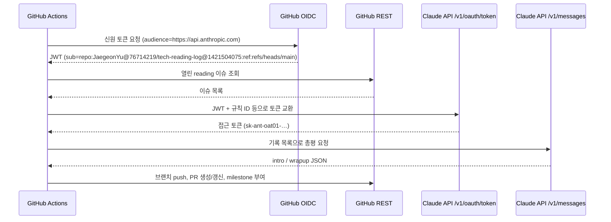

# 요청 흐름과 테스트 가이드

워크플로가 시작돼서 Claude에 요청이 가고 PR이 만들어지기까지의 흐름, 그리고 직접 테스트하는 방법을 정리합니다.

## 1. 전체 흐름

```
[시작]  일요일 18:00 KST cron          또는   Actions → weekly-digest → Run workflow
        (schedule)                            (gh workflow run weekly-digest.yml)
   │
   ▼
[GitHub Actions 러너]  .github/workflows/weekly-digest.yml  (main 브랜치)
   ├─ ① checkout → npm ci → npm test
   ├─ ② Fetch GitHub OIDC token
   │     GitHub 토큰 발급처에 요청 → 신원 토큰(JWT, 약 5분 유효)을 $RUNNER_TEMP/gha-jwt에 저장
   ├─ ③ Build digest: node scripts/digest.mjs
   │     ├─ GitHub REST: 열린 reading 이슈 조회
   │     ├─ Issue Form 본문 파싱 → 기록 목록
   │     ├─ generateSummary()  (scripts/lib.mjs)
   │     │     new Anthropic()  ← API 키 없음. WIF 환경변수 + 토큰 파일 경로만 사용
   │     │     ├─ [Claude API] POST /v1/oauth/token   ← 토큰 교환
   │     │     │     보냄: JWT + 규칙/서비스 계정/조직/workspace ID
   │     │     │     받음: 접근 토큰 sk-ant-oat01-… (10분 유효)
   │     │     └─ [Claude API] POST /v1/messages      ← 실제 Claude 요청
   │     │           model: claude-opus-5-5 (Variable ANTHROPIC_MODEL로 변경 가능)
   │     │           입력: 내가 남긴 제목·키워드·문장·생각 (원문 글은 보내지 않음)
   │     │           출력: {"intro": …, "wrapup": …}
   │     └─ posts/<주차>.md, PR 본문 작성
   ├─ ④ Open or update PR: digest/<주차> 브랜치 push → PR 생성 또는 갱신
   └─ ⑤ Assign week milestone: 포함된 이슈에 <주차> milestone 부여
```



총평 생성(③의 Claude 호출)이 어떤 이유로든 실패하면 템플릿 부분만으로 PR을 만들고, PR 본문 "경고"에 실패 사유를 남깁니다. 워크플로 자체는 성공으로 끝납니다.

## 2. 인증(WIF) 설정값이 있는 곳

| 값 | 위치 |
|---|---|
| `ANTHROPIC_FEDERATION_RULE_ID`, `ANTHROPIC_SERVICE_ACCOUNT_ID`, `ANTHROPIC_ORGANIZATION_ID`, `ANTHROPIC_WORKSPACE_ID` | 저장소 Settings → Secrets and variables → Actions → **Variables** |
| 규칙의 일치 조건 | Claude Console → Settings → Workload identity → 규칙 |
| 인증 시도 기록과 실패 사유 | Claude Console → Workload identity → **History** 탭 |

규칙의 일치 조건(현재 동작하는 값):

```json
"match": {
  "subject_prefix": "repo:JaegeonYu@76714219/tech-reading-log@1421504075:ref:refs/heads/main",
  "audience": "https://api.anthropic.com",
  "claims": {
    "repository_owner": "JaegeonYu",
    "repository": "JaegeonYu/tech-reading-log",
    "ref": "refs/heads/main"
  }
}
```

## 3. 실패 지점별 증상과 확인 방법

설정하면서 실제로 겪은 사례입니다.

| 증상 (PR 본문 경고 / 로그) | 실패 지점 | 원인과 해결 |
|---|---|---|
| `Could not resolve authentication method` | ③ `new Anthropic()` | 인증 수단이 없음. Variables 4개가 등록됐는지 확인. Claude 요청은 나가지 않음 |
| `Token exchange failed with status 401` + History `match_subject_prefix` | ③ 토큰 교환 | GitHub sub에 숫자 ID가 포함됨(`JaegeonYu@76714219/tech-reading-log@1421504075`). 규칙 prefix를 이 형식으로 |
| 같은 401 + History `match_claim_value_mismatch` | ③ 토큰 교환 | claims 값이 토큰과 다름. `repository_owner`에 `@ID`를 붙였거나, `workflow`·`event_name`·`ref_protected` 같은 조건이 남아 있었음. 위 세 개 조건만 남김 |
| History에 기록 없음 | ③ 토큰 교환 | 규칙 ID나 조직 ID 자체가 틀림 |
| `모델이 요청을 거절함` / `max_tokens` / `JSON` | ③ `/v1/messages` | 인증은 성공. 응답 처리 문제이므로 Actions 로그 확인 |
| PR이 안 생기고 ④가 실패 | ④ | 저장소 Settings → Actions → "Allow GitHub Actions to create and approve pull requests" 확인 |

참고:

- `ANTHROPIC_API_KEY` 환경변수가 있으면 SDK가 WIF보다 먼저 사용합니다. 그래서 워크플로에 넣지 않습니다.
- `main`이 아닌 브랜치에서 수동 실행하면 `ref`가 달라 토큰 교환이 거부됩니다.

## 4. 직접 테스트하기

### 테스트 순서

1. **기록 남기기**: Issues → New issue → **읽은 글 기록**으로 실제로 읽은 글 1~3개를 기록합니다. 모바일 앱에서도 한 번 해 보세요.
2. **실행**: Actions → weekly-digest → **Run workflow** (브랜치 `main`, week는 비워 둠)
3. **결과 확인**: 1~2분 뒤 생성되거나 갱신된 `📚 <주차> 주간 기술 읽기` PR에서 아래를 확인합니다.

### 확인 체크리스트

- [ ] 기록한 이슈가 모두 "포함된 기록"에 있고, 작성한 순서대로 나온다
- [ ] PR 본문에 "경고" 섹션이 없다 (있으면 3장 표에서 원인 확인)
- [ ] `posts/<주차>.md`에 도입부와 "이번 주 흐름"이 있다
- [ ] 링크·키워드·인상 깊은 문장이 적은 그대로 들어갔다
- [ ] 총평에 기록에 없는 내용(원문을 읽은 듯한 설명)이 없다
- [ ] 이슈에 `<주차>` milestone이 붙었다
- [ ] 같은 주에 한 번 더 실행하면 새 PR 없이 같은 PR이 갱신된다
- [ ] 초안을 Tistory 에디터 **마크다운 모드**에 붙였을 때 인용, 키워드, 링크가 깨지지 않는다
- [ ] Tistory에 발행한 뒤 PR을 merge하면 이슈가 자동으로 닫힌다

### 실패했을 때

1. PR 본문 "경고"의 메시지로 3장 표에서 실패 지점을 찾습니다.
2. 토큰 교환 실패(401)라면 Claude Console History 탭에서 해당 시각의 `reason`을 확인합니다.
3. 그 밖에는 Actions 실행 로그의 `Build digest` 단계를 확인합니다.

### 테스트 후 정리

테스트용 PR을 merge하지 않고 버리려면 아래를 실행합니다(`<주차>`와 이슈 번호는 바꿔서).

```bash
R=JaegeonYu/tech-reading-log
gh pr close <PR번호> -R $R --delete-branch      # PR 닫기 + digest/<주차> 브랜치 삭제
gh issue close <이슈번호> -R $R                   # 테스트 이슈 닫기
gh api -X DELETE repos/$R/milestones/$(gh api "repos/$R/milestones?state=all" --jq '.[] | select(.title=="<주차>") | .number')
```

테스트 이슈를 닫지 않고 milestone만 지우면 다음 실행에 다시 모입니다.
